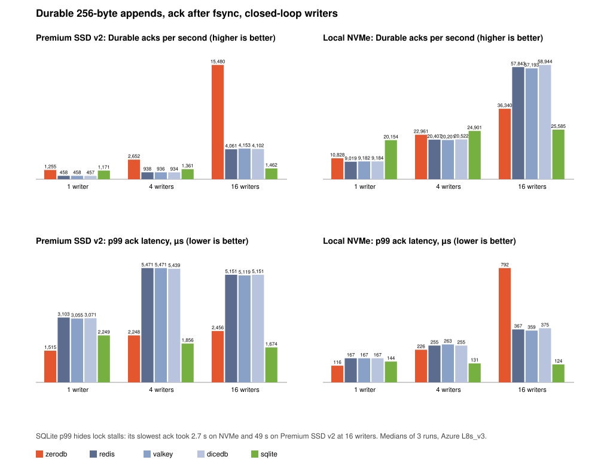

# Head-to-head: durable appends

Run on 2026-10-23. Raw rows: [h2h-nvme.tsv](h2h-nvme.tsv), [h2h-premium-v2.tsv](h2h-premium-v2.tsv), and the agent-shaped `h2h-*-think5.tsv` and `h2h-*-think50.tsv`. Runbook: [h2h.sh](h2h.sh).

Redraw with `python3 bench/h2h_chart.py`. The chart shows the closed-loop runs.

## The question

How fast can each system acknowledge a write that survives power loss? Every client has one request in flight, and every system acks only after `fsync`.

Two loads:
- **Closed loop.** Each writer sends its next append as soon as the last one is acked. This finds the ceiling.
- **Agent-shaped.** Agents call a model between writes. Each writer sleeps a uniform 0 to 2x the think time before every append, seeded by its index, so every system sees the same arrivals. 64 writers with 5 ms think and 256 writers with 50 ms think.

## Setup

- Azure Standard_L8s_v3 (8 vCPU), Linux 7.0, ext4, a freshly formatted disk per pass.
- Two disks: the VM's local NVMe, and a Premium SSD v2 managed disk (128 GiB, 3,000 IOPS, 125 MB/s, host caching off).
- Closed loop: 1, 4 and 16 writers, 5,000 appends of 256 bytes each. Agent-shaped: 1,000 appends per writer at 5 ms, 100 at 50 ms. A fresh data directory per run. Medians of 3 repetitions.
- Docker and the monitoring stack were stopped. With it up, runs fall into a slow mode ([monitoring](monitoring/README.md)).

| System | Version | Durability setting | Workload | Closed-loop client | Agent-shaped client |
|---|---|---|---|---|---|
| zerodb | `d40f048` (`0acce75` + #43) | Always: group commit, ack after `fdatasync` | `POST /v1/append`, one session per writer | `zerodb load`, HTTP over the Unix socket | [h2h_paced.py](h2h_paced.py), Unix socket |
| Redis | 8.10.2 | `appendonly yes`, `appendfsync always` | `RPUSH`, one key per writer when paced | memtier_benchmark 2.5.2, Unix socket, pipeline 1 | [h2h_paced.py](h2h_paced.py), Unix socket |
| Valkey | 9.1.2 | Same | Same | Same | Same |
| DiceDB | 1.0.0 (Valkey 8.0.6 fork) | Same | Same | Same | Same |
| SQLite | 3.45.1 | WAL, `synchronous=FULL`, one row per transaction | `INSERT` | [h2h_sqlite.py](h2h_sqlite.py), one process and connection per writer | Same, with the same seeded think |

Dragonfly is not timed. It has no append-only file, so it cannot acknowledge a write after `fsync` ([docs](https://www.dragonflydb.io/docs/managing-dragonfly/aof)).

`h2h_paced.py` runs one process and one raw socket per writer for zerodb and the Redis family alike, so they pay the same client cost. memtier's `--rate-limiting` was tried first and dropped: it fires every connection on the same clock, so the Redis family got synchronized bursts and about 3x its real p50.

## Premium SSD v2

| Writers | System | Acks/s | p50 µs | p99 µs | p99.9 µs | max µs |
|---|---|---|---|---|---|---|
| 1 | zerodb | 1,271 | 786 | 1,574 | 3,096 | 9,019 |
| 1 | redis | 490 | 2,127 | 3,183 | 4,799 | 8,767 |
| 1 | valkey | 492 | 2,127 | 3,167 | 5,023 | 8,255 |
| 1 | dicedb | 487 | 2,127 | 3,183 | 4,703 | 9,663 |
| 1 | sqlite | 1,150 | 712 | 2,541 | 2,966 | 5,626 |
| 4 | zerodb | 2,986 | 1,415 | 2,339 | 4,154 | 6,928 |
| 4 | redis | 993 | 4,047 | 5,631 | 9,791 | 13,247 |
| 4 | valkey | 966 | 4,159 | 5,663 | 9,215 | 20,479 |
| 4 | dicedb | 1,007 | 3,999 | 5,567 | 10,047 | 17,279 |
| 4 | sqlite | 1,425 | 706 | 2,245 | 2,986 | 10,544,948 |
| 16 | zerodb | 10,083 | 1,598 | 2,553 | 5,366 | 11,783 |
| 16 | redis | 4,047 | 3,935 | 5,471 | 7,967 | 19,583 |
| 16 | valkey | 4,024 | 3,967 | 5,535 | 9,919 | 23,423 |
| 16 | dicedb | 3,910 | 4,063 | 5,535 | 8,703 | 11,903 |
| 16 | sqlite | 1,508 | 704 | 1,752 | 3,038 | 49,091,519 |

Agent-shaped:

| Load | System | Acks/s | p50 µs | p99 µs | p99.9 µs | max µs |
|---|---|---|---|---|---|---|
| 64 writers, 5 ms | zerodb | 9,716 | 1,223 | 2,500 | 4,742 | 8,544 |
| 64 writers, 5 ms | redis | 7,316 | 3,443 | 5,654 | 11,215 | 16,879 |
| 64 writers, 5 ms | valkey | 7,388 | 3,364 | 5,311 | 9,553 | 16,782 |
| 64 writers, 5 ms | dicedb | 7,421 | 3,336 | 5,386 | 9,358 | 12,933 |
| 64 writers, 5 ms | sqlite | 1,090 | 3,870 | 830,082 | 1,830,344 | 4,532,855 |
| 256 writers, 50 ms | zerodb | 4,273 | 1,254 | 2,534 | 5,735 | 7,336 |
| 256 writers, 50 ms | redis | 4,135 | 3,301 | 5,665 | 14,339 | 36,682 |
| 256 writers, 50 ms | valkey | 4,136 | 3,183 | 5,765 | 17,154 | 39,826 |
| 256 writers, 50 ms | dicedb | 4,143 | 3,176 | 5,450 | 12,059 | 27,115 |
| 256 writers, 50 ms | sqlite | 1,050 | 9,133 | 2,131,263 | 3,632,434 | 6,635,919 |

## Local NVMe

| Writers | System | Acks/s | p50 µs | p99 µs | p99.9 µs | max µs |
|---|---|---|---|---|---|---|
| 1 | zerodb | 10,218 | 95 | 131 | 147 | 371 |
| 1 | redis | 8,787 | 111 | 175 | 215 | 343 |
| 1 | valkey | 8,738 | 111 | 175 | 223 | 455 |
| 1 | dicedb | 8,940 | 111 | 167 | 207 | 367 |
| 1 | sqlite | 19,746 | 31 | 160 | 399 | 1,033 |
| 4 | zerodb | 28,072 | 136 | 201 | 232 | 637 |
| 4 | redis | 19,628 | 199 | 279 | 335 | 551 |
| 4 | valkey | 19,595 | 199 | 287 | 335 | 447 |
| 4 | dicedb | 19,513 | 199 | 287 | 335 | 511 |
| 4 | sqlite | 22,333 | 31 | 137 | 693 | 730,431 |
| 16 | zerodb | 54,784 | 282 | 462 | 639 | 1,234 |
| 16 | redis | 52,922 | 303 | 407 | 495 | 1,727 |
| 16 | valkey | 55,287 | 287 | 383 | 463 | 1,711 |
| 16 | dicedb | 57,439 | 279 | 367 | 447 | 1,703 |
| 16 | sqlite | 26,626 | 31 | 124 | 742 | 2,831,688 |

Agent-shaped:

| Load | System | Acks/s | p50 µs | p99 µs | p99.9 µs | max µs |
|---|---|---|---|---|---|---|
| 64 writers, 5 ms | zerodb | 11,656 | 149 | 598 | 959 | 5,395 |
| 64 writers, 5 ms | redis | 11,633 | 186 | 560 | 1,130 | 6,329 |
| 64 writers, 5 ms | valkey | 11,641 | 186 | 507 | 1,018 | 6,651 |
| 64 writers, 5 ms | dicedb | 11,650 | 184 | 342 | 854 | 4,799 |
| 64 writers, 5 ms | sqlite | 8,537 | 58 | 33,383 | 103,548 | 428,933 |
| 256 writers, 50 ms | zerodb | 4,348 | 141 | 631 | 824 | 6,228 |
| 256 writers, 50 ms | redis | 4,352 | 145 | 303 | 2,058 | 6,751 |
| 256 writers, 50 ms | valkey | 4,352 | 144 | 302 | 1,448 | 6,862 |
| 256 writers, 50 ms | dicedb | 4,351 | 146 | 628 | 3,684 | 8,219 |
| 256 writers, 50 ms | sqlite | 4,248 | 71 | 18,518 | 103,932 | 430,141 |

## Why

- **One device round trip, not two.** An append that grows a file makes `fdatasync` also commit the size change to the ext4 journal. Redis-family AOF grows on every write, so each ack costs about two round trips: 2.1 ms on Premium SSD v2. zerodb writes into zero-filled, preallocated segments, and SQLite mostly rewrites its WAL in place. Both pay one round trip, 0.7 ms.
- **Group commit.** zerodb syncs once for all queued writers. On the slow disk that turns 16 writers into 12× its 1-writer throughput. The Redis family groups too, but every group still pays the two round trips.
- **SQLite serializes writers.** Its writers take one lock. A loser sleeps in the busy handler for up to 100 ms per retry. So p50 stays low while throughput stops growing and the max reaches seconds: 2.8 s on NVMe and 49 s on Premium SSD v2 at 16 writers. The percentiles hide it, because the stalled inserts are under 0.1% of samples.
- **SQLite has no socket.** It runs in the writer's process. On fast NVMe with one writer that wins: 31 µs against zerodb's 95 µs, which includes an HTTP round trip over the Unix socket.
- **On NVMe at 16 writers zerodb now ties.** It acks 54.8k/s against 52.9k to 57.4k. Earlier it trailed at 36k. A 200 µs group-commit wait cost more than the 60 µs sync, and #28 removed it (D80). Its p99 is 462 µs against 367 to 407.
- **Retry-key growth stalled the writer.** Each doubling of the per-tenant retry-key map rehashed every key under the state lock: about 6 ms at 57k keys, about 100 ms near 1M. With 64 writers that put zerodb's p99.9 at 6.3 ms. #43 shards the map 64 ways (D81). Now zerodb's p99.9 under agent load is 959 µs and 824 µs on NVMe, against 854 to 3,684 for the Redis family.
- **Agent-shaped on NVMe, zerodb leads at the median and trails at p99.** p50 is 149 µs against about 185 at 64 writers. p99 at 256 writers is 631 µs against 302 to 303 for Redis and Valkey. Profiling for #34 points at thread handoffs: each append hops from a connection thread to the writer thread and back, and waking an idle vCPU costs a hypervisor exit. Pinning every server thread to one vCPU turns 1 writer's p50 from anywhere between 85 and 222 µs into a steady 71 µs (D82).
- **On Premium SSD v2 zerodb leads everywhere.** It acks 2.5x to 3x as many writes as the Redis family in closed loop, and under agent load its p50 is a third of theirs: 1.2 ms against 3.2 to 3.4 ms.

## Run-to-run noise

On this VM the same binary and load sometimes land in a slow mode: 16 writers at about 30k instead of 55k acks/s, or 64 paced writers at p50 356 instead of 132 µs. A run stays in it from start to finish. It showed up in 2 of about 40 runs with the monitoring stack down and in 16 of 16 with it up. The published runs had it down and are medians of 3.

## Not covered

PostgreSQL, Ultra Disk, replicated setups, reads, payloads other than 256 bytes, and writes without `fsync`.
